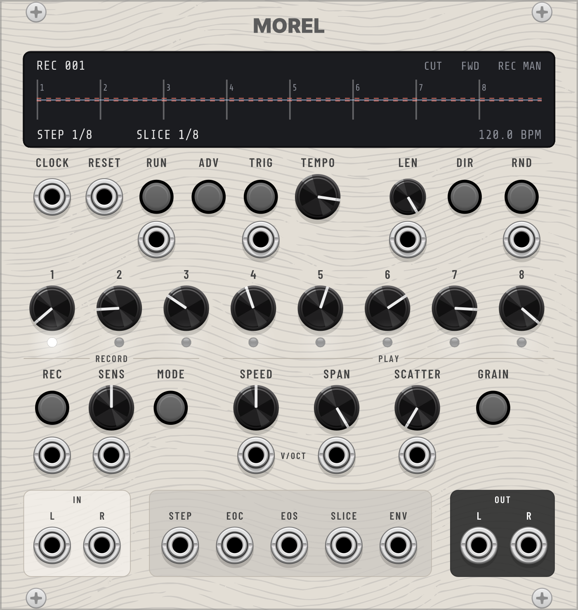

# PaxBonkers – VCV Rack plugins

Modules for [VCV Rack 2](https://vcvrack.com) by [pax.bonkers](https://www.instagram.com/pax.bonkers/). All modules are open source. In Rack you find them in the Library under the brand *pax.bonkers*.

Each module has its own manual in [`docs/`](docs/) with the concept, the operation and the technical specifications.

| Module | Description | Size | Manual |
|---|---|---|---|
| [Morel](#morel) | Records a moment, slices it by level and plays the slices from an 8-step sequencer, as hits or as grains. | 24 HP | [docs/Morel.md](docs/Morel.md) |
| [Zenon](#zenon) | Polymetric percussion: two 8-step tracks with their own length and destination drive a two-oscillator percussion voice. | 36 HP | [docs/Zenon.md](docs/Zenon.md) |
| [Lillebror](#lillebror) | Three drum voices (kick, snare, hi-hat) with wave morph and accent-shaped timbre. The little brother of Grids. | 16 HP | [docs/Lillebror.md](docs/Lillebror.md) |
| [Escarpo](#escarpo) | Clock swing, drift and burst. Delays and ratchets clock pulses by a CV-modulated fraction of the period. | 8 HP | [docs/Escarpo.md](docs/Escarpo.md) |

## Morel

<p align="center">
  
</p>

A slice sampler after Bioy Casares' novel *The Invention of Morel*. It records a moment of stereo audio, cuts it into slices by level and plays them from an 8-step sequencer, as hits (CUT) or as a granular texture (GRAIN). Recording modes include RETRO, which keeps the last bars after they have happened. Recordings are saved with the patch, and WAV files can be loaded.

[Read the Morel manual](docs/Morel.md)

## Zenon

<p align="center">
  
</p>

A percussion synthesizer with a built-in step sequencer, named after Zeno's paradox of Achilles and the tortoise. Two 8-step tracks run on top of each other, each with its own length and destination, so a 5-step pitch line against a 7-step filter line repeats only after 35 steps. Every step triggers a voice with two oscillators, noise, a filter and three decay envelopes.

[Read the Zenon manual](docs/Zenon.md)

## Lillebror

<p align="center">
  
</p>

Three drum voices for the six outputs of Mutable Instruments Grids (Topograph in Rack): kick, snare and hi-hat, each with a waveform morph and accents that change the character of a hit as well as its level. *Lillebror* is Swedish for "little brother".

[Read the Lillebror manual](docs/Lillebror.md)

## Escarpo

<p align="center">
  
</p>

Delays every clock pulse by a fraction of the measured period and can turn each pulse into a burst. With an LFO or random CV on the delay, the clock drifts, breathes and swings against the original. Named after Fragonard's painting *L'Escarpolette*.

[Read the Escarpo manual](docs/Escarpo.md)

## Building

Requires the [VCV Rack SDK](https://vcvrack.com/manual/PluginDevelopmentTutorial) 2.x. All modules are built into one plugin.

```sh
export RACK_DIR=/path/to/Rack-SDK   # defaults to ../Rack-SDK
make
make install
```

Restart Rack afterwards.

Source layout: one `src/<Module>.cpp` per module, Rack-independent DSP in `src/dsp/`, panels in `res/`, tests in `tests/`, manuals in `docs/`.

Unit tests (no Rack needed):

```sh
mkdir -p build
c++ -std=c++11 -Isrc tests/test_swingcore.cpp -o build/test_swingcore && ./build/test_swingcore
c++ -std=c++11 -O2 -Isrc tests/test_lillebror.cpp -o build/test_lillebror && ./build/test_lillebror
c++ -std=c++11 -O2 -Isrc tests/test_zenon_sequencer.cpp -o build/test_zenon_sequencer && ./build/test_zenon_sequencer
c++ -std=c++11 -O2 -Isrc tests/test_zenon_voice.cpp -o build/test_zenon_voice && ./build/test_zenon_voice
for t in sequencer slicer player grain recorder; do c++ -std=c++11 -O2 -Isrc tests/test_morel_$t.cpp -o build/test_morel_$t && ./build/test_morel_$t; done
c++ -std=c++11 -O2 -Isrc tests/test_morel_wav.cpp -o build/test_morel_wav && ./build/test_morel_wav build   # needs a writable temp folder
```

## License

Source code and panels: © [pax.bonkers](https://www.instagram.com/pax.bonkers/), licensed under the [GNU General Public License v3.0 or later](LICENSE).

The Lillebror panel lettering uses outlines of the font Asimovian by Carolina Short (© The Asimovian Project Authors, SIL Open Font License 1.1, see [res/Asimovian-OFL.txt](res/Asimovian-OFL.txt)).

The Morel panel lettering uses outlines of the fonts Inter (© The Inter Project Authors, see [res/Inter-OFL.txt](res/Inter-OFL.txt)) and Barlow Condensed (© The Barlow Project Authors, see [res/BarlowCondensed-OFL.txt](res/BarlowCondensed-OFL.txt)), both under the SIL Open Font License 1.1. The Morel display uses the font Share Tech Mono that ships with VCV Rack; it is loaded from the Rack installation.

Knobs, jacks, buttons, screws and lights are drawn by VCV Rack's built-in Component Library (© VCV, CC BY-NC 4.0). Their graphics are loaded from the Rack installation and are not part of this repository.

Mutable Instruments and Grids are names of their respective owners. Lillebror is an independent project and contains no code from Grids.
