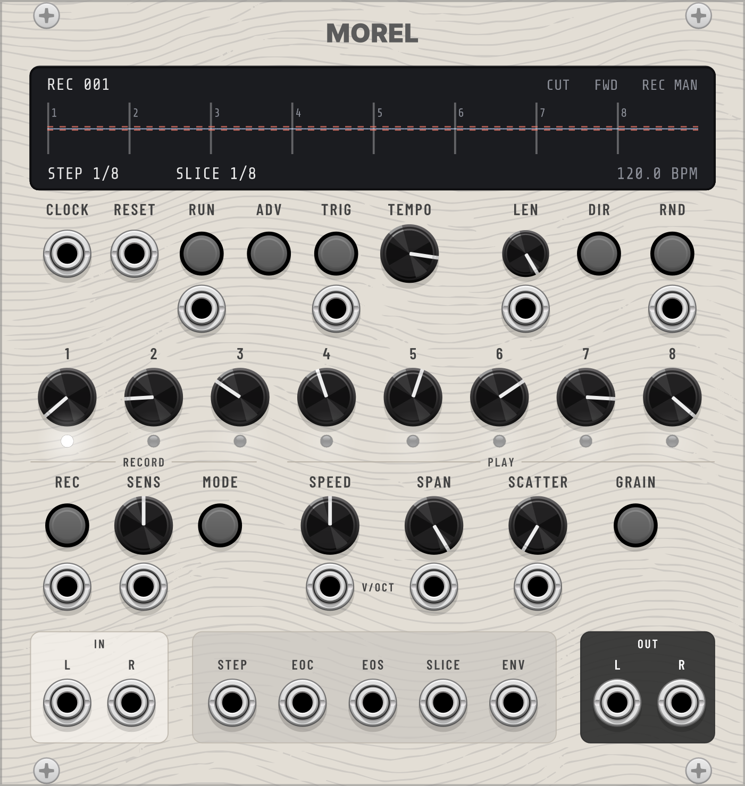

# Morel

  

*A machine that makes a past moment habitable.* 24 HP, stereo, monophonic in the Rack sense. Part of the [PaxBonkers](../README.md) plugin by pax.bonkers.

- [Concept](#concept)
- [Getting started](#getting-started)
- [Operation](#operation)
- [Technical specifications](#technical-specifications)
- [Patch ideas](#patch-ideas)

## Concept

In Adolfo Bioy Casares' novel *La invención de Morel* (*The Invention of Morel*, 1940), a fugitive reaches an island where the people seem strangely out of reach and keep repeating the same actions. What he takes for the present is a recording. Morel's machine has captured a week on the island, with all its sights and sounds, and plays it again and again, driven by the tides.

Morel the module is that machine. It records a moment of audio, finds the hits in it, cuts it into slices and plays them back from an 8-step sequencer, endlessly and driven from outside by a clock. In CUT mode every step plays its slice as a hit. In GRAIN mode the current slice becomes a granular texture that keeps sounding.

Every recording replaces the whole previous one. There is no overdub and no re-recording of single slices. The old material keeps playing until the new recording is ready, so the loop never stops for a recording.

Morel is a slice sampler in the wider family of the Make Noise Morphagene, with its own panel, functions and names.

## Getting started

1. Patch an audio source (a drum loop works well) into IN L, and into IN R for stereo.
2. Patch OUT L and OUT R to your mixer, at low volume.
3. Press RUN, then press REC. Press REC again after a few bars.
4. The display shows the new waveform with slice markers. Turn SENS to get more or fewer slices.
5. Turn the step knobs 1–8 to choose which slice each step plays. Press RND for a random pattern.
6. Press GRAIN to turn the current slice into a texture, and turn SPAN and SCATTER.

## Operation

### Transport

| Control / port | Range | Function |
|---|---|---|
| TEMPO | 40–800 steps/min, default 480 (120 BPM in sixteenths). With CLOCK patched: /4, /2, ×1, ×2, ×4 | Internal clock, or divider/multiplier of the external clock |
| RUN button / input | on/off, a trigger toggles | Starts and stops the sequencer |
| ADV | button | One step forward, also while stopped |
| TRIG button / input | button, trigger | Plays the current step again without advancing |
| CLOCK | trigger | Replaces the internal clock. Pulses count only while RUN is on |
| RESET | trigger | The next step is the first step of the cycle. The clock phase and divider start again |

### Sequencer

| Control / port | Range | Function |
|---|---|---|
| Step knobs 1–8 | 0–100 % | Choose the slice. With N slices, a step plays slice ⌊value × N⌋ + 1 (the top end plays slice N). The defaults spread the 8 steps evenly over all slices |
| Step LEDs | | Current step bright, steps within the length dimmed, steps beyond it off |
| LEN + input | 1–8 steps, default 8 | 1 V = 1 step, added, rounded and limited to 1–8 |
| DIR | FWD, REV, PEND, SHUF | Each press selects the next direction. Also in the context menu |
| RND button / input | button, trigger | New random values for all 8 step knobs |

The four directions:

- FWD plays 1 to LEN and starts again.
- REV plays LEN down to 1. After reset it starts at step LEN.
- PEND goes back and forth without playing the end steps twice: 1-2-3-4-3-2-1-2 …
- SHUF plays all steps in a new random order every cycle. The first step of a new order is never the last step of the previous one.

If you shorten LEN below the current position, FWD and PEND jump to step 1 on the next step and REV to step LEN.

EOC fires at the end of each cycle: with FWD on the jump from LEN to 1, with REV on the jump from 1 to LEN, with PEND on every return to step 1, and with SHUF on the first step of every new order. It does not fire on the first step after start or reset. At LEN 1 it fires on every step from the second one on.

Without material the sequencer still runs and STEP and EOC still fire; the steps are silent.

### Slicing

SENS (0–100 %, default 50 %) sets how many slices Morel finds. The SENS input adds 1 V = 10 %.

Morel follows the level of the recording and starts a new slice where the level rises above a threshold. The threshold is relative to the loudest point of the recording: 0 dB at SENS 0 % (only the loudest hit), −48 dB at SENS 100 %. The display draws the threshold as a dashed line. If fewer than 2 slices are found, Morel cuts the material into 8 equal slices.

Slicing runs in the background and follows SENS while the sequencer plays.

### Recording

| Control / port | Function |
|---|---|
| IN L / IN R | Audio input. With only L patched, L is recorded on both sides. The input is not passed to the outputs |
| REC button / input | Starts, stops or arms a recording, depending on the mode |
| MODE | MAN, CLK, LVL, RETRO. Each press selects the next mode. Also in the context menu |
| Bars (context menu) | 1, 2, 4 or 8 bars for CLK and RETRO, default 2. One bar is 16 steps |

The four recording modes:

- MAN: REC starts, REC stops.
- CLK: REC arms. Recording starts on the next step and stops after the chosen number of bars, exactly on a step. REC stops it early.
- LVL: REC arms. Recording starts when the input reaches −30 dBFS (0.158 V relative to 5 V). REC stops.
- RETRO: while RETRO is selected, Morel records continuously into a ring buffer. REC takes the last 1, 2, 4 or 8 bars as the new recording, so you can keep a moment after it has happened. Without a clock, and while stopped, the bar length follows the internal tempo.

While Morel is armed, the REC light blinks and the display says ARMED. Pressing REC again or changing the mode cancels.

The new recording takes over at the next EOC or RESET, or at once when the sequencer is stopped. Recordings are named REC 001, REC 002 and so on.

### Playback

| Control / port | Range | Function |
|---|---|---|
| SPEED + V/OCT | −2 … +2 octaves, V/OCT 1 V/oct | Pitch and speed together, like tape. Knob plus CV is limited to ±5 octaves. No reverse playback |
| SPAN + input | 1–100 %, default 100 %, 1 V = 10 % | CUT: how much of the slice is played. GRAIN: grain size |
| SCATTER + input | 0–100 %, default 0 %, 1 V = 10 % | Random variation, see below |
| GRAIN | CUT / GRAIN | Light on = GRAIN |

In CUT mode every step starts its slice and plays the first SPAN × slice length, followed by silence until the next step. If a step arrives while the previous slice is still sounding, Morel crossfades in 3 ms. SCATTER moves the start up to 20 ms later, changes the pitch by up to ±1 semitone and lowers the level by up to 6 dB, chosen anew on every step.

In GRAIN mode four overlapping grains play from the current slice. SPAN sets the grain size from 10 ms to the whole slice. A read head moves slowly through the slice and wraps at its end. SCATTER shifts each grain's position by up to half the slice length and its pitch by up to ±7 semitones. On a new step, new grains start in the new slice while the old ones fade out. The texture keeps sounding while the sequencer is stopped.

Switching from CUT to GRAIN continues the last slice as a texture at once. Switching back stops new grains; CUT plays from the next step.

### Outputs

| Port | Signal |
|---|---|
| OUT L, OUT R | Audio at the recorded level |
| STEP | 10 V trigger, 1 ms, on every step |
| EOC | 10 V trigger, 1 ms, at the end of a cycle |
| EOS | 10 V trigger, 1 ms. CUT: at the end of the slice or the SPAN cut. GRAIN: when the read head wraps |
| SLICE | Index of the playing slice, 0 V for the first to 10 V for the last. Holds until the next step |
| ENV | Envelope of the output (attack 1 ms, release 50 ms), 5 V peak = 10 V |

### Display

The top line shows the source (REC nnn or a file name; red while recording), then CUT or GRAIN, the direction and the recording mode, with the number of bars for CLK and RETRO. ARMED and loading errors appear in red next to the name.

The middle shows the waveform with numbered slice markers, the current slice, the SENS threshold and the playhead. While recording, the new waveform runs in red over the old one.

The bottom line shows the step, the slice, the recording time and the tempo or clock factor.

### Files and patches

Load WAV… in the context menu loads a WAV file instead of a recording. The file name appears in the display, and the file is sliced and switched in like a recording. Files are not loaded while Morel is recording or armed.

The playing material is saved with the patch as `recording.wav` in the module's patch storage folder and comes back when you load the patch. Initialize clears it.

## Technical specifications

| | |
|---|---|
| Width | 24 HP |
| Polyphony | Mono in the Rack sense: only channel 0 of each input is read, all outputs have one channel. Audio is stereo over two jacks |
| Trigger, clock and gate inputs | Schmitt trigger, high at ≥ 1 V, low at ≤ 0.1 V |
| Trigger outputs | 10 V, 1 ms |
| CV inputs | Added to the knob. NaN or Inf counts as 0 V |
| Memory | Two buffers of 2 880 000 stereo frames (60 s at 48 kHz), about 46 MB, reserved when the module is created. The RETRO ring buffer adds about 23 MB the first time RETRO is selected |
| Maximum recording | 60 s up to 48 kHz; shorter at higher sample rates (30 s at 96 kHz, 15 s at 192 kHz). Recordings shorter than 50 ms are discarded |
| Slicing | Envelope follower on L + R (attack 1 ms, release 30 ms), 6 dB hysteresis, minimum slice length 40 ms, markers moved up to 5 ms back to the nearest zero crossing, slice 1 always at the start, up to 32 slices. Runs in a background thread |
| Interpolation | 4-point Hermite |
| CUT | Fade in 0.5 ms, fade out 3 ms, 3 ms crossfade between steps |
| GRAIN | 4 voices, Hann window, a new grain every half grain length (2× overlap), read head at 25 % of the playback speed. Grain size exponential over SPAN: 1 % = 10 ms, 100 % = whole slice |
| Sample rate | Recordings and files keep their own sample rate and play at the right pitch at any engine rate. Changing the engine rate keeps the material |
| WAV files | Read: PCM 8, 16, 24 and 32 bit, float 32 and 64 bit, WAVE_FORMAT_EXTENSIBLE, any sample rate, mono (on both sides) or two and more channels (the first two are used). Full scale = 5 V. Longer files are cut at 2 880 000 frames |
| Saved file | `recording.wav`, 32-bit float stereo, own sample rate, 5 V = 1.0. Removed when Morel is empty at save time |
| Patch data | Bars, recording counter and source name. Missing or invalid values fall back to 2 bars, counter 0, no name |
| Not saved | Sequencer position and divider count (Morel starts at the first step after loading), the RETRO ring buffer, a finished recording that is still waiting for EOC |
| Real-time safety | Slicing, file reading and writing and the RETRO copy run outside the audio thread. The audio thread does no memory allocation or file I/O |
| Initialize | All parameters to default, 2 bars, sequencer to the first step, recording cleared, counter to 0 |
| Bypass | All outputs silent |

The DIR and MODE orders are stored in patches and will not change.

## Patch ideas

- A drum loop into IN, MODE on RETRO, Morel clocked with the loop: press REC whenever a good bar has just happened.
- EOC into RND: a new slice pattern every cycle.
- GRAIN with slow modulation on SPAN and SCATTER: a pad from a single spoken word.
- SLICE into a filter cutoff: each slice gets its own colour.
- ENV into a VCA on another voice: the slices drive the dynamics of the rest of the patch.
