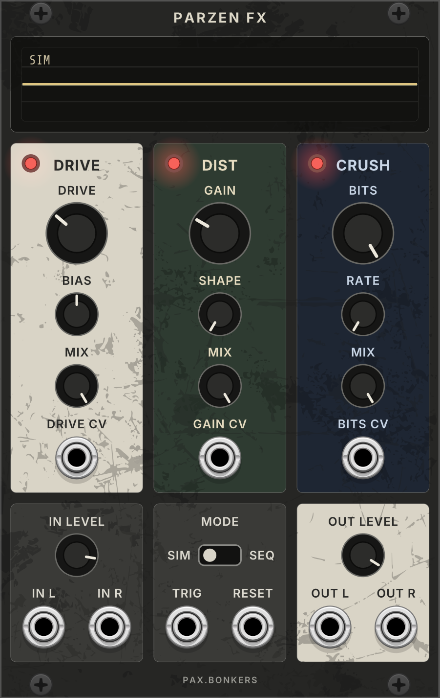

# Parzen FX

  

*Three devices, one thread.* 16 HP, stereo, monophonic in the Rack sense. Part of the [PaxBonkers](../README.md) plugin by pax.bonkers.

- [Concept](#concept)
- [Getting started](#getting-started)
- [Operation](#operation)
- [Technical specifications](#technical-specifications)
- [Patch ideas](#patch-ideas)

## Concept

In Roman mythology the Parcae decide over the thread of life: one spins it, one measures it out, one cuts it. Parzen FX puts three effects in a row in the same order. **DRIVE** spins the signal thicker with soft saturation. **DIST** measures it against a hard limit or folds it back. **CRUSH** cuts it into steps.

The three lanes look like three old outboard devices in one rack. They work either all at once on the same signal (**SIM**) or one after the other: every trigger hands the thread on to the next lane (**SEQ**). A scope window above the lanes shows what happens to the waveform.

## Getting started

1. Patch audio into IN L (and IN R for stereo) and OUT L / OUT R to your mixer, at low volume.
2. With MODE on SIM, all three lanes run in series. Turn DRIVE, GAIN and BITS and watch the scope.
3. Turn a lane's MIX down to 0 % to take it out of the chain.
4. Switch MODE to SEQ and patch a clock or trigger sequence into TRIG. Every trigger moves on to the next lane: DRIVE → DIST → CRUSH → DRIVE. RESET goes back to DRIVE.

## Operation

### Lanes

Each lane has a main knob with its own CV input, a character knob and a MIX knob.

| Lane | Main knob (+ CV) | Character | MIX |
|---|---|---|---|
| DRIVE | DRIVE, 0 … +36 dB, default +12 dB | BIAS, −1 … +1, default 0 | 0 … 100 %, default 100 % |
| DIST | GAIN, 0 … +40 dB, default +12 dB | SHAPE, 0 … 100 %, default 0 % | 0 … 100 %, default 100 % |
| CRUSH | BITS, 16 … 1, default 16 | RATE, full sample rate … 200 Hz, default full rate | 0 … 100 %, default 100 % |

- **DRIVE** feeds a tanh saturator. The level is compensated, so a full-scale signal stays at about the same level at every DRIVE setting: more drive changes the character more than the volume. **BIAS** shifts the curve for asymmetric saturation with even harmonics. The DC offset this creates is removed.
- **DIST** amplifies by GAIN and then clips or folds. **SHAPE** at 0 % is a hard clipper, at 100 % a sine wavefolder, and in between a blend of both. At MIX 100 % the output of this lane stays within ±5 V.
- **CRUSH** samples and holds at the RATE frequency (shown in Hz when you hover the knob) and then reduces the resolution to BITS. Both work continuously, so 7.5 bits is a valid setting. At 16 bits and full rate CRUSH is transparent.
- **MIX** blends the lane's output with its own input. At 0 % the lane passes the signal unchanged.
- **CV** inputs are added to the lane's main knob (DRIVE, GAIN, BITS): 1 V moves the knob by 10 % of its range.

### Mode and sequence

- **MODE SIM:** the lanes run in series, DRIVE → DIST → CRUSH.
- **MODE SEQ:** exactly one lane is active and processes the input on its own. The other two are bypassed.
- **TRIG** (SEQ only): next lane, DRIVE → DIST → CRUSH → DRIVE.
- **RESET** (SEQ only): back to DRIVE.
- Every change of mode or lane crossfades in 5 ms, so switching does not click. A trigger during a crossfade continues from what you hear at that moment.
- **Lamps:** in SEQ the lamp of the active lane is lit. In SIM each lamp shows its lane's MIX.

### Levels

- **IN LEVEL** (off … +12 dB, default 0 dB) sets the level before the effects and drives all lanes harder or softer.
- **OUT LEVEL** (off … +6 dB, default 0 dB) sets the level after the effects.
- **IN R** is normalled to IN L: with only IN L patched, both outputs carry the processed left signal.

### Scope

- OUT L and OUT R are drawn in the colour of the cable plugged into each output. Without a cable, L is amber and R is light blue.
- A faint white line shows IN L after IN LEVEL for comparison.
- The vertical range is ±10 V. The picture starts on a rising zero crossing of IN L, so periodic signals stand still. Without a zero crossing it runs freely.
- Top left: the mode and, in SEQ, the active lane.

### Context menu

- **Scope time window:** 2 ms, 10 ms (default) or 50 ms. Saved with the patch.

## Technical specifications

| | |
|---|---|
| Width | 16 HP |
| Channels | Stereo via two jacks. Mono in the Rack sense: only channel 0 of each input is read; all outputs have one channel |
| Signal levels | Internal 1.0 = 5 V. No limiting at the outputs |
| Trigger inputs | Schmitt trigger, high at ≥ 1 V, low at ≤ 0.1 V |
| CV inputs | Added to the knob, 1 V = 10 % of the knob range, clamped to the range |
| DRIVE | y = (tanh(g·x + b) − tanh(b)) / tanh(g), followed by a 5 Hz DC blocker |
| DIST | Hard clip at ±1, sine wavefolder sin(π/2 · g·x), crossfaded by SHAPE |
| CRUSH | Sample & hold, then 2^(BITS−1) steps per polarity. No oversampling; the aliasing is part of the sound |
| Oversampling | DRIVE and DIST run at 4× with Rack's resampler. The MIX blend happens inside the oversampled domain, so partial MIX settings do not comb-filter |
| Crossfades | 5 ms linear for MODE, TRIG and RESET. All lane configurations run all the time, so a crossfade never meets a cold state |
| Level smoothing | IN LEVEL and OUT LEVEL, 10 ms |
| Sample rate | All times and filters follow the current sample rate. Unit tests at 44.1, 48, 96 and 192 kHz |
| Saved with the patch | All knobs and the MODE switch, plus the scope time window. The active SEQ lane is not saved; SEQ starts at DRIVE after loading |
| Initialize | All parameters to default, SEQ to DRIVE, scope window 10 ms |
| Bypass | IN L/R pass straight to OUT L/R |

## Patch ideas

- **Rhythmic textures:** MODE on SEQ, one trigger per bar into TRIG. Every bar a different device takes over the same loop.
- **Fills on demand:** a drum fill trigger into TRIG and the bar clock into RESET. The fill jumps to DIST or CRUSH and the next bar starts clean on DRIVE.
- **Breathing crusher:** a slow LFO into CRUSH CV, MIX around 50 %. The resolution falls and rises while the dry signal holds it together.
- **Folding bass:** a sine or triangle bass into IN L, DIST SHAPE at 70 … 100 % and an envelope into GAIN CV. The fold opens with every note.
- **Tape-style warmth:** only DRIVE (DIST and CRUSH MIX at 0 %), BIAS slightly positive, IN LEVEL a few dB up.
